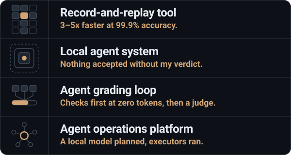

  <picture>
    <source media="(prefers-color-scheme: dark)" srcset="assets/header-dark.svg">
    <source media="(prefers-color-scheme: light)" srcset="assets/header-light.svg">
    
  </picture>

Agent systems and the evaluation harnesses that prove they work. Chicago metro, open to full-time roles.

> [!NOTE]
> Most of my repos are private. I can walk through code on a call.

## Selected work

<picture>
  <source media="(prefers-color-scheme: dark)" srcset="assets/projects-dark.svg">
  <source media="(prefers-color-scheme: light)" srcset="assets/projects-light.svg">
  
</picture>

## Stack

**Build** `Python` `TypeScript` `Node.js` `AutoHotkey`

**Agents and infra** `MCP` `local LLMs` `LLM-as-judge evals` `Claude Code` `Linux` `Docker` `Git` `Zapier` `Make`
