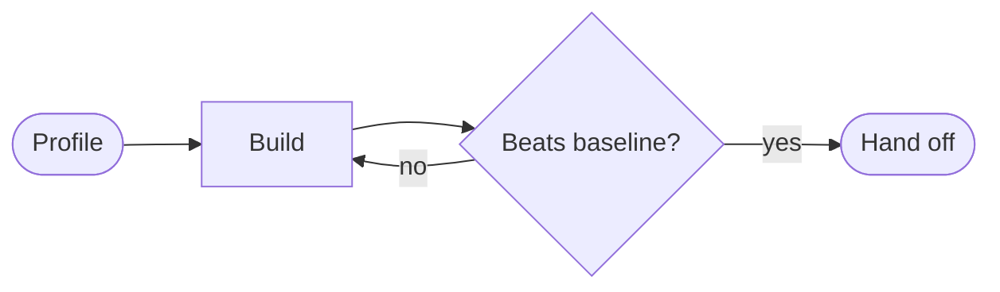

  <picture>
    <source media="(prefers-color-scheme: dark)" srcset="assets/header-dark.svg">
    <source media="(prefers-color-scheme: light)" srcset="assets/header-light.svg">
    
  </picture>

I spent years on a production line watching skilled people do work a computer should be doing. So I built the computer's half.

Now I build agent systems and the evaluation harnesses that prove they work. Based in the Chicago metro area, open to full-time roles: onsite nearby, hybrid, or remote.

> [!NOTE]
> Most of my repos are private: client work and things still in progress. I can walk through code on a call.

## How I work

Profile the manual workflow, build the smallest fix, and compare it to the hand-timed baseline. If it doesn't win, it goes back. If it does, it ships with tests and docs.

## What I've built

### Record-and-replay automation tool
**AutoHotkey, Windows, zero install**

I was an operator on an autonomy annotation pipeline and spotted a high-volume repetitive sub-task. I built the fix on my own time.

One timed task: **30s by hand, 6s on replay**. **3–5x faster** across tasks at **99.9% accuracy**, matching the standard. Validated with the engineering team, staged for deployment, SOPs and onboarding docs written solo.

### Local agent system
**Python, one Windows PC, 16 GB GPU, since July 2026**

A local model researches the public web read-only through a fail-closed fetcher and tests its own patches in a network-free sandbox.

Everything lands in quarantine. Nothing is accepted without my verdict, written to a hash-chained log. It never publishes, spends, or merges on its own. About 2,800 unit tests.

### Agent grading loop
**Deterministic checks first, then an LLM judge**

Checks that cost zero tokens run first. A rubric judge then grades one criterion per call and fails closed. The loop stops on a pass, an iteration cap, a deadline, or a token budget.

Built so "the agent worked" is a measurement, not a vibe. Since parked.

### Agent operations platform
**Python, a VPS and a home GPU, March to June 2026**

A control plane where a local model planned the work, agents ran in their own tool loop, and deterministic executors took mechanical tasks with no LLM call. Task state lived in files. I ran it, then moved everything local.

## Now

- **Local-first AI.** Fitting a good model onto one graphics card, and checking its work: tests, judges, and the cases where they get it wrong.
- **A wall display at home.** A digital photo frame rebuilt with calendars, weather, notes, and photos. A small service I wrote pushes updates, each person who can update it only gets their own corner, and remote access is locked to one computer.

## Stack

**Languages** `Python` `TypeScript` `Node.js` `AutoHotkey`

**AI and agents** `MCP` `local LLMs` `LLM-as-judge evals` `Claude Code` `Cursor`

**Infra and integration** `Linux` `Docker` `Git` `AppContainer sandboxing` `Zapier` `Make`

<b>Operating rules</b>

 

- **Notice first, build second.** The bottleneck nobody flagged is worth more than the feature everyone requested.
- **Measure it or don't claim it.** Every number here traces to a hand-timed baseline or a scored run. Ranges, not headline figures.
- **Ship the boring version.** Zero dependencies beats a clever framework when someone else has to run it at 3am.
- **Write the docs yourself.** A tool nobody can onboard onto dies with you.
- **AI-assisted development daily since 2024.** Agent loops, sub-agent orchestration, and persistent state are how I build, not something I read about.

<b>Background</b>

 

Audio engineering, then manufacturing, then automation engineering. Not the standard path, and I'd argue that's the point.

Signal processing, latency budgets, and "it has to work live, right now, in front of people" turn out to be the same constraints as real-time systems work. Years of high-volume production taught me to spot a bottleneck before anyone files a ticket about it.

